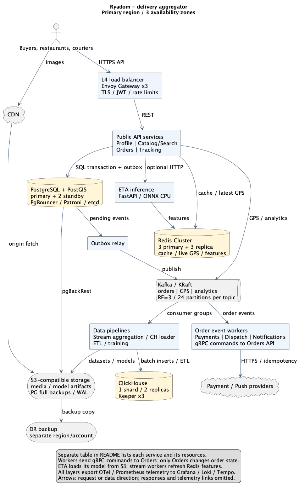

# Рядом — агрегатор доставки из ресторанов

Расчётно-пояснительная записка по проектированию распределённой высоконагруженной системы. Тема: сервис (агрегатор) доставки. Проектный масштаб — **1,2 млн активных покупателей в месяц** в России.

**Содержание:** [1. Постановка проекта](#scope) · [2. Продуктовые и технические метрики](#metrics) · [3. Балансировка нагрузки](#balancing) · [4. Системы хранения данных](#storage) · [5. Программные инструменты и аппаратное обеспечение](#software) · [6. Взаимодействие компонентов](#interaction) · [7. Обработка данных и ETA](#processing) · [8. Обеспечение надёжности](#reliability) · [9. Проверка полноты и воспроизводимость](#validation) · [Источники](#sources) · [Последовательность выполнения](#stages)

<a id="scope"></a>

## 1. Постановка проекта

### Назначение и аудитория

«Рядом» связывает покупателей, рестораны и курьеров: покупатель выбирает блюда ближайших ресторанов, оформляет и оплачивает заказ, ресторан подтверждает приготовление, курьер доставляет заказ. Сервис решает задачу заказа еды с прозрачным статусом и прогнозом прибытия.

Основная аудитория — жители крупных городов России, заказывающие готовую еду домой и на работу. Дополнительные пользователи — сотрудники ресторанов, курьеры и операторы поддержки. Их трафик рассчитывается отдельно и не включается в MAU покупателей.

### Аналоги и актуальность

| Аналог | Первичный источник | Что подтверждает |
|---|---|---|
| Яндекс Еда | [Пресс-релиз от 10.03.2025](https://ir.yandex.ru/press-releases?id=01-10-03-2025&year=2025) | Более 1 млн заказов за 8 марта 2025 года в России; заказы более чем из 51 тыс. ресторанов. Подтверждает существование массовой локальной доставки и праздничных пиков |
| Яндекс Еда: масштаб аудитории | [Официальная страница команды](https://yandex.ru/jobs/services/eda) (проверена 23.11.2026) | Более 20 млн MAU; отчётный период и разрез по странам на странице не указаны, поэтому это ориентир масштаба, а не российская статистика |
| DoorDash | [Результаты 2025 года, опубликованы 18.02.2026](https://ir.doordash.com/news/news-details/2026/DoorDash-Releases-Fourth-Quarter-and-Full-Year-2025-Financial-Results/default.aspx) | Более 56 млн MAU на конец 2025 года на маркетплейсах группы. Подтверждает международный масштаб бизнес-модели, но не является оценкой российского рынка |

Внешние числа относятся к указанным отчётным периодам. Метрики далее — собственная модель нового сервиса, а не статистика этих компаний. Оценка серверов будет предварительной до нагрузочного тестирования.

### Ключевые функции MVP

1. Поиск ресторанов по адресу, кухне и доступности; просмотр меню.
2. Корзина, оформление и оплата заказа через внешнего платёжного провайдера.
3. Приём заказа рестораном и назначение свободного курьера.
4. Отслеживание статуса и положения курьера с прогнозом времени доставки.
5. Уведомления об изменении заказа и доступная поддержке история операций.

Для MVP один заказ относится к одному ресторану. Собственная платёжная система, складской учёт, доставка товаров из магазинов и межгород исключены из продуктового объёма. Отличительная архитектурная задача — согласовать заказ и оплату с внешними системами, одновременно обрабатывая частые геопозиции курьеров. Прогноз ETA не должен блокировать оформление заказа.

### Границы и ограничения

Начальная цель — 1,2 млн MAU; география включает Москву и область, Санкт-Петербург и область, другие города-миллионники. Высокая активность вечером и в праздники требует расчёта пиков. Операционные данные размещаются в одном основном регионе с несколькими независимыми зонами отказа; выбор конкретного провайдера будет зависеть от доступности такой инфраструктуры.

В системе есть транзакционные сущности (заказы, платежи), изменяемый каталог, временные геоданные, изображения и аналитические события. У них различаются частота обновления, срок хранения и требования к консистентности. Архитектура должна учитывать эти различия.

<a id="metrics"></a>

## 2. Продуктовые и технические метрики

### 2.1. Исходные допущения и аудитория

Расчётный месяц — 30 дней, год хранения — 365 дней. GB = 10⁹ B, TB = 10¹² B, kB = 1000 B; RAM в GiB. Все размеры — средние оценки полезных данных без HTTP/TLS, индексов и реплик, если прямо не указано иное. Внешние источники подтверждают нишу; география, конверсия, размеры сообщений и коэффициенты ниже — **проектные допущения**, проверяемые после запуска. Не выводим российский MAU из международного MAU DoorDash.

MAU оценивается сценарием сверху вниз с опорой на реальный масштаб аналога: [официальная страница Яндекс Еды](https://yandex.ru/jobs/services/eda) указывает >20 млн MAU, но не раскрывает страны/период. Берём 20 млн как опорный масштаб, затем **предполагаем** 75% для РФ и 80% для выбранных городов: `20 млн ×0,75 ×0,80 =12 млн` адресуемой аудитории. Целевая доля использования нового сервиса 10% даёт `12 млн ×0,10 =1,2 млн MAU`. Все три коэффициента — сценарные допущения, не опубликованные доли Яндекса. Это не подсчёт населения и не измеренная доля рынка; пользователи нескольких агрегаторов могут пересекаться. Достижимость 10% требует продуктового исследования. При доле 5% аудитория была бы 0,6 млн, при 20% —2,4 млн; проектируем базовый сценарий 1,2 млн и рост ×2.

| География | Адресуемая аудитория, допущение | Доля MAU | MAU | DAU при 25% |
|---|---:|---:|---:|---:|
| Москва и Московская область | 5 400 000 | 45% | 540 000 | 135 000 |
| Санкт-Петербург и Ленинградская область | 2 400 000 | 20% | 240 000 | 60 000 |
| Другие города-миллионники РФ | 4 200 000 | 35% | 420 000 | 105 000 |
| **Всего** | **12 000 000** | **100%** | **1 200 000** | **300 000** |

| Продуктовая метрика | Расчёт | Значение |
|---|---|---:|
| MAU покупателей | 12 млн × 10% | 1 200 000 |
| DAU покупателей | MAU × 25% | 300 000 |
| Зарегистрированные покупатели | MAU × 2 | 2 400 000 |
| Заказы в день | DAU × 0,4 | 120 000 |
| Заказы за 30 дней | 120 000 × 30 | 3 600 000 |
| Частота на MAU | 3 600 000 / 1 200 000 | 3 заказа/месяц |
| Среднее число позиций заказа | Допущение | 5 |
| Рестораны / блюда | 10 000 × 100 блюд | 10 000 / 1 000 000 |
| Активные курьеры | 20 000 за сутки, смена 6 часов | 20 000 |
| Производительность курьера | 120 000 / (20 000 × 6) | 1 доставка/час смены |
| GPS | Каждые 10 секунд активной смены | 43 200 000 сообщений/сутки |
| Пиковый коэффициент покупательского трафика | Вечер/праздник | 6 × среднесуточный RPS |
| Пиковый коэффициент GPS | Все 20 000 одновременно на линии | 4 × среднесуточный RPS |
| Горизонт роста | Двукратный сценарий через 12 месяцев | 2 400 000 MAU |

На пике 8,33 заказа/s ≈30 тыс./h. При 20 тыс. одновременно доступных курьеров это требует 1,5 доставки/h на курьера (40 min на цикл), выше среднесуточной 1/h за счёт меньшего простоя. Если район не обеспечивает эту скорость, admission control ограничивает приём до оплаты. Это операционное допущение, требующее проверки по городам.

Действия одного активного покупателя за день: 24 открытия каталога/меню, 6 поисков, 4 изменения корзины, 0,4 оформления, 8 проверок статуса, 2 обращения к профилю/истории. Всего 44,4 API-запроса/DAU/день; доли заказов — среднее по аудитории. Статус: в среднем 20 запросов на заказ (например, 20 минут наблюдения с интервалом 60 секунд). Отдельно на заказ приходятся 6 команд ресторанов/курьеров и 2 платёжных callback. На каждого курьера — 2160 GPS-сообщений/день.

### 2.2. Средний объём данных на пользователя

Объём нормирован на MAU, включая неактивные зарегистрированные профили; это позволяет умножить столбец GB на 1,2 млн и получить общий объём. Это не размер локального приложения. Данные заказа включают снимок цены, адреса и выбранных блюд; строки позиций и история указаны отдельно, без повторного включения в размер заголовка.

| Тип | Количество на 1 MAU | Средний размер записи | GB на 1 MAU | Срок |
|---|---:|---:|---:|---|
| Профиль | 2 | 2 kB | 0,000004000 | Активная база |
| Адрес | 4 | 0,3 kB | 0,000001200 | Активная база |
| Заголовок заказа | 36,5 | 4 kB | 0,000146000 | 365 дней |
| Позиции заказа | 182,5 | 0,3 kB | 0,000054750 | 365 дней |
| Платёжные операции | 73 | 0,5 kB | 0,000036500 | 365 дней |
| История статусов | 292 | 0,2 kB | 0,000058400 | 365 дней |
| **Персональные/операционные строки всего** | **590** | — | **0,000300850** | Разные сроки |
| Общий каталог, амортизированный | 0,00833 ресторана + 0,83333 блюда | 4 / 2 kB | 0,000001700 | Текущая версия |
| Общие изображения, амортизированные | 2,5 объекта | 100 kB | 0,000250000 | Текущие версии |

### 2.3. Нагрузка и сеть

`RPS_avg = запросы_за_сутки / 86400`; `RPS_peak = RPS_avg × K`. Ниже пик — консервативная сумма совпадающих пиков. Дополнительные попытки и внутренние RPC в эти внешние RPS не включены; на них выделяется отдельный резерв в ресурсах.

| Тип запроса | Запросов/сутки | Средний RPS | Пиковый RPS | Запрос / ответ, kB |
|---|---:|---:|---:|---:|
| Каталог и меню | 7 200 000 | 83,33 | 500,00 | 1 / 20 |
| Поиск | 1 800 000 | 20,83 | 125,00 | 1 / 10 |
| Корзина | 1 200 000 | 13,89 | 83,33 | 2 / 2 |
| Оформление заказа | 120 000 | 1,39 | 8,33 | 4 / 3 |
| Статус заказа | 2 400 000 | 27,78 | 166,67 | 0,5 / 1 |
| Профиль и история | 600 000 | 6,94 | 41,67 | 1 / 2 |
| Геопозиции курьеров | 43 200 000 | 500,00 | 2 000,00 | 0,2 / 0,1 |
| Команды ресторанов/курьеров | 720 000 | 8,33 | 50,00 | 2 / 0,5 |
| Платёжные callbacks | 240 000 | 2,78 | 16,67 | 2 / 0,5 |
| **Всего API** | **57 480 000** | **665,28** | **2 991,67** | — |

| Трафик | Вход/сутки | Выход/сутки | Пиковый вход | Пиковый выход |
|---|---:|---:|---:|---:|
| Полезные данные API | 24,24 GB | 173,16 GB | 11,87 Mbit/s | 95,40 Mbit/s |
| API: 300 B накладных расходов/сообщение +30% резерв | 53,93 GB | 247,53 GB | 24,76 Mbit/s | 133,35 Mbit/s |
| Изображения CDN → клиенты | — | 2,16 TB | — | 1 200 Mbit/s |
| S3 → CDN, hit ratio 95% | — | 0,108 TB | — | 60 Mbit/s |

Изображения: `300 000 × 24 страницы × 10 миниатюр × 30 kB = 2,16 TB/сутки`. Это консервативно, без повторного браузерного кэша. CDN не проходит через API. Умножение на пик 6 даёт 1,2 Gbit/s; origin обслуживает 5% промахов, но при холодном CDN возможны все 1,2 Gbit/s: нужны origin shield, request coalescing и ограничение fetch. Для API сначала прибавляем 300 B заголовков/служебных данных к каждому запросу и ответу, затем умножаем на 1,3. Это особенно важно для коротких GPS; фактический overhead зависит от HTTP/2 reuse и TLS. API + CDN дают около 1,333 Gbit/s клиентского пика с этим транспортным запасом для API. Внутренняя репликация, WAL и бэкапы добавляются при выборе сетей хранения.

Минимум для edge API — два независимых пути по 1 Gbit/s; серверная сеть хранения — 10 Gbit/s для восстановления и репликации. При росте ×2 ожидаем 5 983 RPS API и 2,4 Gbit/s CDN до запаса. Проверяем 1×/2×/4× профиль и отказ одной зоны.

### 2.4. Логические данные по категориям

| Данные | Записей/объектов | Полезный объём, TB | Расчёт / срок |
|---|---:|---:|---|
| Профили | 2 400 000 | 0,004800 | 2 kB/профиль |
| Адреса | 4 800 000 | 0,001440 | 0,3 kB/адрес |
| Рестораны | 10 000 | 0,000040 | 4 kB/ресторан |
| Блюда | 1 000 000 | 0,002000 | 2 kB/блюдо |
| Заказы | 43 800 000 | 0,175200 | 120 000 × 365 × 4 kB |
| Позиции заказов | 219 000 000 | 0,065700 | 5/заказ, 0,3 kB |
| Платёжные операции | 87 600 000 | 0,043800 | 2/заказ, 0,5 kB |
| История статусов | 350 400 000 | 0,070080 | 8/заказ, 0,2 kB |
| Исходящие события outbox | 8 400 000 | 0,004200 | 10/заказ, 7 дней, 0,5 kB |
| Ключи идемпотентности | 840 000 | 0,000336 | 1/заказ, 7 дней, 0,4 kB |
| Изображения | 3 000 000 | 0,300000 | 3 версии/блюдо, в среднем 100 kB |
| GPS-история | 302 400 000 | 0,030240 | 7 дней, 100 B после упаковки |
| История доменных событий | 438 000 000 | 0,219000 | 365 дней, 500 B до сжатия |
| Клиентская аналитика | 540 000 000 | 0,108000 | 20/DAU/день, 90 дней, 200 B |

Корзины и кэш, брокер, резервные копии и диагностическая телеметрия рассчитываются отдельно на этапе хранения: это дополнительные копии или временные данные. Логи: `57,48 млн × 300 B = 17,244 GB/день` до сжатия, без тел запросов. Размеры API-body включают небольшие пакеты клиентской аналитики. Клики отправляются в уже учтённых запросах клиента; отдельного HTTP-запроса на каждый клик нет.

Расчёт RPS и сети воспроизводится командой `python3 scripts/capacity.py` (только стандартная библиотека Python 3). Скрипт проверяет суточную сумму запросов и объёмы сети; результаты являются моделью, а не результатами бенчмарка.

<a id="balancing"></a>

## 3. Балансировка нагрузки

| Участок | Инструмент / алгоритм | Обоснование, альтернатива |
|---|---|---|
| Пользователь → регион | DNS одного основного региона, резервный адрес для DR | Низкий операционный бюджет при одной стране; geo-DNS для active-active пока не нужен. DNS TTL 60 s не гарантирует мгновенное переключение из-за клиентских кэшей |
| Интернет → зоны | Управляемый L4 TCP-балансировщик, распределение по потоку | Единая точка входа без отдельного VIP-сервера; backend в 3 зонах. HA самого балансировщика — требование к поставщику, не свойство одного экземпляра |
| L4 → edge | 3 экземпляра Envoy Gateway в 3 зонах; TLS, маршруты по пути/клиенту | В одном слое HTTP/2, gRPC, JWT, лимиты и метрики. NGINX достаточен для REST, но Envoy удобнее для единых gRPC-политик; отдельный API-management продукт для MVP избыточен |
| Edge → сервисы | Envoy `least_request`, одинаковые веса здоровых pod | Разная длительность поиска, checkout и GPS; меньше риск назначить запрос занятому pod. Round-robin годится для одинаковых коротких запросов, но слабее учитывает очередь |
| Внутренние gRPC | Клиентское `round_robin`, headless DNS и несколько каналов | Распределение по pod, а не закрепление HTTP/2-канала за одним ClusterIP endpoint. Переподключение и обновление DNS обязательны; это проверяется при drain pod |
| Kafka consumers | Партиционирование по order_id / courier_id, consumer group | Сохраняем порядок одного агрегата; независимые ключи обрабатываются параллельно. Это распределение работы, не HTTP-балансировка |
| Изображения | CDN, ключ — версия объекта | Снимает большую часть исходящего трафика с origin; смена версии URL исключает массовые purge |

[Envoy описывает алгоритмы upstream-балансировки](https://www.envoyproxy.io/docs/envoy/latest/intro/arch_overview/upstream/load_balancing/load_balancers); [NGINX документирует round-robin, least-connected и веса](https://nginx.org/en/docs/http/load_balancing.html). Выбор Envoy связан с планируемыми протоколами, а не с предположением, что NGINX не умеет gRPC.

Readiness pod исключает неготовый экземпляр из endpoints; Envoy дополнительно выполняет активный health check каждые 5 s, timeout 1 s, исключение после 2 неудач, возврат после 3 успехов. Passive outlier detection выводит backend с серией сетевых/5xx ошибок на 30 s с ограничением доли исключённых узлов. L4 проверяет готовность edge, edge проверяет сервисы. Liveness не зависит от доступности БД, чтобы её сбой не вызывал массовые рестарты.

Сессии хранятся вне pod; sticky sessions/IP-hash не нужны, общий NAT не должен перегружать один узел. JWT проверяется локально по кэшируемому набору ключей. Лимиты раздельные: GPS, поиск и checkout имеют собственные очереди и бюджеты. Для checkout нет автоматического повтора POST на edge; при перегрузке — 429 с Retry-After. При rollout сначала readiness=false, затем drain и завершение начатых запросов; HPA учитывает CPU, inflight и задержку очереди, а не только RPS.

<a id="storage"></a>

## 4. Системы хранения данных

### 4.1. Выбор хранилищ и модели доступа

| Категория | Хранилище / источник истины | Паттерн и обоснование | Альтернатива и причина отказа |
|---|---|---|---|
| Профили, адреса, рестораны, меню | PostgreSQL 17 + PostGIS | Связи, ограничения, транзакции; GiST по точкам ресторанов, GIN полнотекстового поиска по меню. 125 search RPS не требуют отдельного поискового кластера | MongoDB не упрощает связи и проверки заказа; OpenSearch добавит согласование ещё одной копии каталога |
| Заказы, позиции, операции оплаты, назначения, история, idempotency, outbox | PostgreSQL | ACID внутри одной БД и уникальные ограничения защищают от дублей и двух назначений. Отдельные схемы и роли сервисов; операции с заказом принадлежат Orders | Cassandra/Scylla подходят для больших потоков, но здесь важнее ограничения и транзакции, а десятки checkout RPS невелики |
| Кэш меню/поиска, корзины, текущие GPS и признаки ETA | Redis Cluster | TTL, атомарное обновление версии позиции, быстрый доступ по ключу; корзина — временное состояние, финальный состав сохраняется в заказе | Memcached не даёт нужных структур и атомарных сценариев; PostgreSQL не должен принимать каждую GPS-точку |
| События заказов, GPS и клиентская аналитика для доставки | Kafka 4.1, отдельные topics | Несколько независимых потребителей, replay и порядок в рамках ключа; retention 3 дня | RabbitMQ удобнее для очереди задач, но поток телеметрии и многократное перечитывание требуют журнала; NATS JetStream возможен, но Kafka объединяет журнал с аналитическими consumers |
| GPS за 7 дней, события заказов за год, клики за 90 дней | ClickHouse, ReplicatedMergeTree | Вставки пачками и сканирование колонок; отделение аналитики от OLTP | TimescaleDB проще для SQL time-series, но совместная аналитика событий и сильное сжатие колонок полезнее; wide-column потребовал бы внешнюю агрегацию |
| Изображения, бэкапы, модели, учебные датасеты | Управляемое S3-совместимое хранилище в РФ | Большие immutable-объекты и lifecycle; изображения через CDN. Поставщик должен подтвердить versioning, шифрование, object lock и межзонную избыточность | Файлы на pod теряются при пересоздании; PostgreSQL bytea увеличивает WAL и размер бэкапов |
| Метрики | Два Prometheus, Grafana | Числовые временные ряды и локальные запросы для алертов; две независимые копии | ClickHouse не заменяет готовую систему правил мониторинга |
| Логи и трассы | Loki / Tempo, данные в S3 | Диагностика по trace_id; не индексируем все тела сообщений | Полнотекстовый OpenSearch дороже по индексу, а основные запросы — сервис/период/trace_id |
| Координация | etcd для Patroni; Kafka KRaft; ClickHouse Keeper | Отдельные кворумы по 3 узла в 3 зонах, каждый в своём домене отказа | Один etcd на все продукты связывает отказы и протоколы; ZooKeeper для Kafka KRaft не нужен |

Redis не является источником истины для оплаты, заказа или назначения курьера. Корзина имеет TTL 24 h; при потере клиент повторно передаёт состав, цены и доступность проверяются сервером. Кэш меню TTL 60 s с jitter ±20%, stale-while-revalidate до 5 min; цена в checkout всегда читается из PostgreSQL. GPS TTL 120 s, признаки ETA TTL 10 min; устаревшее положение помечается временем последнего обновления. Отдельная векторная/графовая БД не нужна: ETA использует табличные признаки, география — PostGIS.

### 4.2. Ёмкости, репликация и рост

Базовый год — полный срок retention при постоянном текущем потоке. Рост ×2 означает консервативно весь retention на удвоенном потоке, а не точный интеграл постепенного роста. `D_required = D_one_copy × copies × 2 / 0,70`. Свободные 30% нужны для compaction, vacuum и восстановления. Для S3 коэффициент 1,5 — **расчётный эквивалент erasure coding**, а не утверждение о внутреннем устройстве поставщика; квоты заказываются по логическим данным, фактическую физическую избыточность подтверждает поставщик.

| Система | Объекты и полезные данные | Коэффициенты одной копии | Физический эквивалент сейчас, TB | При росте ×2 + 30% свободно, TB |
|---|---|---|---:|---:|
| PostgreSQL | 718,25 млн строк; 0,367596 TB из таблицы §2.4 | ×2 на индексы, служебные поля, bloat; 3 копии | 2,205576 | 6,301646, плюс 0,3 TB WAL-резерва |
| Redis | 1 млн кэш-ключей ×2 kB +150 тыс. корзин ×2 kB +20 тыс. GPS ×0,5 kB +1 млн признаков ×0,5 kB =2,81 GB | ×3 на структуры/allocator; 3 шарда ×2 копии | 0,016860 RAM | 0,048171 RAM |
| Kafka | 151,2 млн сообщений за 3 дня; 0,031320 TB | ×1,2 на индексы/сегменты, RF=3; сжатие не учитываем | 0,112752 | 0,322149 |
| ClickHouse | 1 280,4 млн строк; 0,357240 TB до сжатия | /4 сжатие, ×1,3 индексы/merges, 2 реплики одного шарда | 0,232206 | 0,663446 |
| S3: медиа, бэкапы, ML | 3 млн медиа (0,3 TB), 2 полных PG-бэкапа (2×0,735192 TB), WAL 14×0,02 TB, ML 0,01 TB; CH-бэкапы 0,200040 TB, старые media-версии 0,03 TB; итого 2,290424 TB | EC-эквивалент ×1,5; без выгоды сжатия бэкапов | 3,435636 | 9,816103 |
| S3: независимая DR-копия | Те же 2,290424 TB: PG/WAL, CH-бэкапы, медиа/версии и ML | EC-эквивалент ×1,5 в другом регионе/аккаунте | 3,435636 | 9,816103 |
| Prometheus (2 копии) | 500 тыс. активных series ×5760 samples/день ×14 дней ×2 B =0,080640 TB/копию | ×2 копии | 0,161280 | 0,460800 |
| Loki/Tempo в S3 | Логи: 17,244 GB/день ×14 /4; traces: 1%×57,48 млн/день ×1 kB ×14 /4; итого 0,062366 TB | EC-эквивалент ×1,5 | 0,093549 | 0,267282 |
| Кворумы координации | Обычно <1 GB состояния на кластер, лимит размера etcd/Keeper контролируется | 3 независимых узла для каждого из 3 кластеров | Резерв дисков по инвентарю | Рост определяется числом объектов, не GPS |

Kafka: в день `43,2 млн×200 B +1,2 млн×500 B +6 млн×200 B =10,44 GB`; 50,4 млн сообщений/день. ClickHouse хранит ту же GPS-историю уже упакованной по 100 B/точку; отличие от 200 B сообщения — удаление envelope. Доменные события: 10/заказ включают смены статуса и платежи; 6 команд и 2 callback из внешней модели не считаются ещё раз. Ретенции и форматы — обязательные настройки пайплайна, а коэффициент сжатия 4 проверяется на выборке.

PostgreSQL: размер 0,367596 TB включает историю назначений/статусов; таблица назначений — текущая проекция строки заказа, не ещё одна годовая копия. Inbox потребителей, таблицы заданий и служебные индексы входят в коэффициент ×2; если замеры выйдут за него, квоты пересчитываются. Удалённый backup — отдельная копия сверх трёх online-реплик; в DR также копируются CH-бэкапы и медиа/ML-артефакты. Не суммируем логические объёмы с физическими как независимые данные.

S3 дополнительно учитывает CH-backup: `2 ×0,357240/4 +14 ×(4,32+0,6+1,2) GB/4 =0,200040 TB` (два full и 14 дневных incremental). Старые версии медиа: при замене 10% изображений за месяц и retention 30 дней ещё `0,3 ×10% =0,03 TB`. Это допущение об изменяемости, контролируемое lifecycle. В DR копируется тот же набор. В 10 GB служебного/ML-бюджета входят последние 5 моделей, ограниченные training snapshots, малые quorum snapshots и суточные агрегаты SLO; превышение квоты требует очистки/пересчёта, а не бесконечного накопления.

### 4.3. Аппаратные ресурсы хранения

Все CPU ниже — выделенные vCPU общего назначения x86-64 с AES-NI, RAM — ECC DDR4/DDR5 на стороне хоста. NVMe с защитой от потери питания важнее максимальной паспортной скорости. Числа IOPS — требования к закупке и тесту, не обещанная производительность ПО. Диски в TB; порты 10 Gbit/s. Хранилища располагаются на отдельных VM с резервированными ресурсами, вне пула stateless pod.

| Система | Экземпляры × ресурсы на экземпляр | Диск на экземпляр | Обоснование |
|---|---|---|---|
| PostgreSQL + PostGIS | 3 × (16 vCPU, 64 GiB) | 3,84 TB NVMe, ≥20 тыс. random IOPS, ≥500 MB/s | Вся БД и индексы при росте занимают ~1,47 TB/реплику; RAM — горячие индексы/буферы, NVMe — WAL fsync и vacuum. Пороги 70% включают WAL/временные файлы |
| Redis Cluster | 6 × (4 vCPU, 16 GiB) | 100 GB SSD для ОС/диагностики | 3 primary +3 replica, `maxmemory=10 GiB` на узел; текущие данные ~2,81 GB/shard с overhead, при ×2 ~5,62 GB. Оставляем RAM для replication buffers/allocator |
| Kafka brokers | 3 × (8 vCPU, 32 GiB) | 500 GB SSD, ≥5 тыс. IOPS, ≥300 MB/s | Полезный поток невелик; 32 GiB нужны page cache, 3 диска — HA и replay, не высокая средняя пропускная способность |
| ClickHouse | 2 × (16 vCPU, 64 GiB) | 1,92 TB NVMe, ≥10 тыс. IOPS, ≥500 MB/s | Держат одинаковый шард в разных зонах; RAM/CPU для сканов и merges, запас диска для перестроения частей. До шардирования увеличиваем ресурсы вертикально |
| Patroni etcd / Kafka controllers / CH Keeper | 9 × (2 vCPU, 4 GiB), по 3 на продукт | 40 GB SSD, ≥1 тыс. IOPS с устойчивым fsync | Малые независимые кворумы; нужны малая latency и отсутствие noisy neighbor |
| Prometheus | 2 × (4 vCPU, 16 GiB) | 400 GB SSD, ≥3 тыс. IOPS | По ~230 GB на рост ×2 и свободное место, оставшееся — WAL/head/индекс; оценка 2 B/sample не включает весь индекс |
| S3/CDN | Управляемая услуга, CPU/RAM поставщика | Основная логическая квота 7 TB, DR-квота 7 TB, телеметрия 0,3 TB при ×2 | Квоты выше расчётных логических объёмов; API ≥250 MB/s для restore. Физические серверы в наш инвентарь не включаются |

Межзонный RTT для синхронного PG — целевой ≤3 ms p95, внутри зоны ≤1 ms. Порты 10 Gbit/s нужны для восстановления: копия PG 1,47 TB при устойчивых 250 MB/s передаётся минимум ~98 min; к этому добавляются WAL replay, проверки и переключение. При работающем кластере это не обещание RTO, а нижняя оценка передачи. Нельзя считать паспортные 10 Gbit/s гарантией скорости restore.

### 4.4. Эксплуатация каждой системы

| Система | Конфигурация, консистентность и защита | Метрики и масштабирование |
|---|---|---|
| PostgreSQL | Patroni, один primary +2 standby в 3 зонах; strict synchronous mode, подтверждение одного standby, `synchronous_commit=on`. Fencing старого primary до promotion. PgBouncer, бюджет ≤200 активных backend на primary. pgBackRest: full еженедельно, WAL непрерывно в S3, 14 дней PITR; DR-копия в отдельном аккаунте | postgres_exporter: replication lag, WAL/archive failures, oldest transaction, deadlocks, connection saturation, cache hit, disk/fsync. Заказы остаются непартиционированными с глобальным PK order_id; позиции и история делятся по месяцу с составными ключами. UNIQUE ключей идемпотентности хранится в отдельной непартиционированной таблице. Сначала read replicas для каталога, затем шардирование заказов по городу, если замеры потребуют |
| Redis | 3 шарда и по 1 replica; primary/replica разнесены по зонам. Репликация асинхронная, потеря последних обновлений допустима для кэша. `allkeys-lfu`, TTL всех ключей, AOF выключен; сохранность корзины не гарантируется. Запись GPS через compare seq Lua-script | redis_exporter: used_memory/maxmemory, fragmentation, evictions, hit ratio, replication lag. Запросы при miss ограничены semaphore, coalescing и token bucket; reshard при >65% maxmemory. Падение replica не должно выбивать соседний primary |
| Kafka | RF=3, `min.insync.replicas=2`, producer `acks=all`, idempotence, запрет unclean leader election. По 24 партиции для GPS, orders и analytics; RF по зонам, KRaft 3 controller. Retention 72 h и лимит bytes с alert до удаления непрочитанных данных | JMX exporter: ISR, offline partitions, produce latency, disk, consumer lag в секундах и offset. По 24 consumer-потока максимум на topic; partitions меняют осознанно, чтобы не нарушить порядок ключа. Replay до 3 дней; критические события восстанавливаются также из PG/outbox/архива |
| ClickHouse | Один шард ×2 реплики, Keeper 3 узла; ReplicatedMergeTree, месячные партиции для orders/analytics и дневные для GPS; TTL 365/90/7 дней. Вставки ≥10 тыс. строк или раз в 5 s; аналитика eventual | system.metrics, replication_queue, parts, merge backlog, query p95, disk, oldest event time. Еженедельный full backup данных/схем и ежедневные incremental в S3, retention 14 дней; PG/outbox и Kafka дают повторную загрузку, за retention Kafka нужна история из CH backup. Ограничение memory/threads на запрос, шардирование по restaurant_id при насыщении |
| S3 | Разные buckets/roles для публичных медиа и закрытых бэкапов; versioning и object lock бэкапов 14 дней; checksum, lifecycle старых media-версий 30 дней, ML-артефактов — 10 GB бюджет | Запросы 4xx/5xx, first-byte latency, quota, возраст последнего backup/WAL, checksum и независимая проба чтения. Изображения — immutable URL; бесконечный versioning не допускается, иначе расчёт не ограничен |
| Prometheus / Loki / Tempo | Prometheus по одному в 2 зонах, independent scrape, Alertmanager 3 replica. Retention 14 дней; Loki/Tempo в S3, 1% traces, все traces ошибок в пределах квоты. Ошибки не должны переполнить бюджет | cardinality, scrape failures, ingestion lag, dropped spans, disk. Исключаем user_id/order_id из labels; идентификаторы только в логах/трассах. Дополнительный мониторинг из DR проверяет работоспособность самих алертов |
| etcd / KRaft / Keeper | У каждого кластера 3 участника, кворум 2; разные зоны. Снимки конфигурации ежедневно в закрытый bucket. Нельзя одновременно обновлять 2 узла кворума | leader changes, fsync p99, quorum/peer RTT, размер состояния. Масштабирование данных через шардирование сервисов, а не бесконечное увеличение числа участников consensus |

Основания: [синхронная репликация PostgreSQL 17](https://www.postgresql.org/docs/17/warm-standby.html), [PITR](https://www.postgresql.org/docs/17/continuous-archiving.html), [ограничения асинхронной Redis replication](https://redis.io/docs/latest/operate/oss_and_stack/management/replication/), [Kafka producer settings](https://kafka.apache.org/41/configuration/producer-configs/), [ClickHouse replication](https://clickhouse.com/docs/reference/engines/table-engines/mergetree-family/replication), [объектная модель S3](https://docs.aws.amazon.com/AmazonS3/latest/userguide/Welcome.html). Гарантии конкретного S3-совместимого провайдера проверяются отдельно от документации Amazon S3.

<a id="software"></a>

## 5. Программные инструменты и аппаратное обеспечение

### 5.1. Компоненты, языки и runtime

| Компонент | Язык / runtime / библиотеки | Роль и причины выбора |
|---|---|---|
| Edge | Envoy Gateway, нативный C++ runtime | Готовый сетевой proxy с HTTP/2, JWT, лимитами и управляемыми upstream, без самостоятельной реализации TLS |
| Profile / Identity | Go, `net/http`, chi, pgx, JWT/JWKS | Профиль, адреса, авторизация ролей; компактный сетевой сервис, ограниченные пулы соединений |
| Catalog / Search | Go, chi, pgx, PostGIS/SQL | Поиск ближайших ресторанов и меню; SQL для индексов и параметризованных запросов, без ORM-скрытых N+1 |
| Orders API | Go, chi, grpc-go, protobuf, pgx | Единственный владелец состояния заказа, операций оплаты и назначения; транзакции, idempotency и outbox |
| Tracking | Go, chi, grpc-go, go-redis, franz-go | Приём GPS и выдача статуса; отдельный pool, чтобы 2000 GPS RPS не вытесняли оформление |
| Dispatch | Go, grpc-go, franz-go | Слушает готовые к доставке заказы, ищет курьера в геоячейке, запрашивает атомарное назначение через Orders |
| Payments | Go, `net/http`, grpc-go, franz-go | Взаимодействие с PSP, подписи callback, повторные проверки; состояние изменяет через Orders, собственных независимых платёжных таблиц нет |
| Notifications | Go, franz-go, HTTP client | Уведомления через внешних поставщиков, лимиты по каналу и дедупликация |
| Outbox relay | Go, pgx, franz-go | Читает outbox и публикует события; это служебный компонент домена Orders с узкими DB-правами |
| Stream workers / CH loader | Go, franz-go, clickhouse-go | Отбрасывают старые GPS по seq, обновляют признаки и грузят пачки событий в ClickHouse |
| ETA serving | Python, FastAPI/Uvicorn, ONNX Runtime CPU | Единый артефакт обученной табличной модели, независимый срок обновления; тонкая HTTP-обёртка для serving, Orders использует короткий REST-вызов через отдельный клиент |
| ETL / обучение | Python, Polars, scikit-learn; Kubernetes CronJob | Подготовка датасетов и небольшая модель ETA. Групповые преобразования вынесены из пользовательского пути |
| Наблюдаемость | OTel SDK/Collector, Prometheus, Grafana, Loki, Tempo, Alertmanager | Готовые средства сбора, хранения и корреляции телеметрии, без собственного языка/фреймворка |

Go выбран для I/O-bound API: goroutine дешевле отдельного OS thread на запрос, стандартный HTTP-стек и контекст дедлайна доступны во всех сервисах. GC всё же тратит CPU: ограничиваем размеры JSON/body, используем streaming decode, bounded queues, переиспользуем protobuf buffers только после профилирования; контролируем heap, allocation rate, GC pause и RSS. `GOMEMLIMIT` задаётся ниже container memory limit с запасом для стека и native memory. Это компромисс со сложностью Rust и большим базовым heap JVM, а не обещание нулевых пауз. Основание: [руководство Go по GC](https://go.dev/doc/gc-guide).

Внутри — типизированный protobuf для доменных RPC, снаружи — JSON для веба и мобильных клиентов. Пул HTTP/2-каналов переиспользуется; один канал не считается балансировкой между всеми pod ([gRPC performance](https://grpc.io/docs/guides/performance/)). Python не используется на GPS-пути: GIL и цена объектов там лишние. FastAPI обрабатывает I/O асинхронно, ONNX выполняет CPU-работу в native runtime с ограничением числа потоков; несколько Uvicorn workers дублируют модель в памяти. [Документация FastAPI](https://fastapi.tiangolo.com/async/) различает конкурентность I/O и CPU-параллелизм.

### 5.2. Архитектурная схема



[Исходник PlantUML](docs/diagrams/architecture.puml). Изображение хранится в репозитории и читается без внешнего рендера. На схеме сгруппированы public API и order workers; отдельные сервисы, роли и ресурсы перечислены в таблицах. Все stateful-компоненты имеют независимые копии, в надписях указаны кворумы/репликация. Стрелки показывают инициатора запроса или направление данных; ответы опущены. Для ETA используется HTTP/JSON, для команд состояния — gRPC.

### 5.3. Ресурсы сервисов и размещение

Ресурсы ниже — **плановые requests**, а не результаты измерения. CPU-limit допускает burst до ×2 при свободных ядрах, memory-limit — до ×1,5 requests; HPA/очереди должны предотвращать OOM. Число копий выбрано для трёх зон, даже когда RPS обслужил бы один процесс. Таблицы обработки на этапе 5 ссылаются на эти же экземпляры, повторно серверы не прибавляются.

| Компонент | Копий | vCPU / GiB на копию | Основание |
|---|---:|---:|---|
| Envoy | 3 | 2 / 2 | TLS, JWT и ~3 тыс. RPS; после потери зоны остаются 2 экземпляра |
| Profile | 3 | 1 / 1 | ~42 peak RPS, малая доля CPU и соединений |
| Catalog/Search | 3 | 2 / 4 | 625 peak RPS, сериализация меню и локальный короткий кэш |
| Orders | 3 | 2 / 4 | ~8 checkout +50 команд +17 callback +статусы и внутренние команды; запас на транзакции, не только checkout |
| Tracking | 3 | 2 / 2 | GPS и status отдельно от заказов; RAM для короткой очереди, не для всей истории |
| Dispatch | 3 | 1 / 2 | Ограниченный поиск кандидатов, событийное назначение |
| Payments | 3 | 1 / 1 | I/O внешнего PSP, отдельные semaphore и таймауты |
| Notifications | 3 | 1 / 1 | Внешние квоты и небольшие payload |
| Outbox relay | 3 | 1 / 1 | ~14 avg доменных событий/s, до ~84 peak/s |
| Stream workers | 3 | 2 / 4 | До ~2500 сообщений/s из GPS, заказов и аналитики, ограниченные buffers |
| CH loader | 3 | 1 / 2 | Буфер до 10 тыс. строк/5 s и batch insert |
| ETA serving | 3 | 2 / 2 | CPU-инференс малой табличной модели, model +native runtime |
| ETL / CronJob coordinator | 2 | 2 / 4 | Задания по расписанию, экспорт признаков и контроль качества |
| Обучение ETA, временный Job | 1 | 8 / 16 | Полная дневная выборка; останавливается первым при дефиците CPU |
| OTel, Loki, Tempo, Grafana, Alertmanager суммарно | 3 зональных бюджета | 2 / 4 | Указан общий бюджет нескольких небольших deployment в каждой зоне; Prometheus уже в §4.3 |
| **Сумма включая активное обучение** | — | **72 vCPU /114 GiB** | Бюджет pod, не число физических ядер |

Расчёт CPU как проверяемая гипотеза: на peak GPS ~2000/s и 0,5 ms CPU/request →1 vCPU; поиск/каталог 625/s ×2 ms →1,25 vCPU; внешние сервисы и обработка потребителей добавляют свои расходы. Эти времена заданы для sizing и требуют pprof/k6 замеров. На отказ зоны предусмотрены несколько копий и лимиты; число pod само по себе не доказывает throughput.

Пул приложений: **9 VM ×16 vCPU /64 GiB /200 GB SSD**, по 3 VM в зоне, 10 Gbit/s, SSD ≥3000 IOPS/200 MB/s. CPU общего назначения 2,5+ GHz; здесь важны сеть и память, постоянные данные живут вне pod. После потери зоны: 96 vCPU /384 GiB; после 25% системного резерва —72 vCPU /288 GiB. Это покрывает requests; обучение/ETL при аварии приостанавливаются, освобождая CPU для HPA. Для роста ×2 планируем увеличение до 15 worker VM после проверки профиля, а не утверждаем, что базовые 9 VM гарантированно выдержат двойную нагрузку.

Kubernetes control plane — управляемый, эквивалент 3×2 vCPU/8 GiB/40 GB SSD в 3 зонах. Docker/OCI стандартизирует сборку; containerd запускает контейнеры. VM/KVM изолируют ядро и ресурсы, контейнеры изолируют процессы внутри VM. Kubernetes даёт rollout, discovery и autoscaling для нескольких сервисов; Docker Compose достаточно для локальных integration-тестов, но не для межзонной HA. Sidecar service mesh для MVP не нужен: mTLS и клиентские политики выполняются явно, без дополнительного proxy в каждом pod.

`topologySpreadConstraints`, anti-affinity и PDB `minAvailable=2` удерживают по копии в каждой зоне; PDB защищает только добровольные disruption. Requests планируются до отказа, Cluster Autoscaler не заменяет готовый резерв. HPA: CPU target 60%, очередь/lag и inflight; ограниченный scale-down и предварительный scale-up перед пиком. Stateful VM из §4.3 в пул worker не входят. [Kubernetes Deployment](https://kubernetes.io/docs/concepts/workloads/controllers/deployment/) и [HPA](https://kubernetes.io/docs/concepts/workloads/autoscaling/horizontal-pod-autoscale/) — основания механизмов, не SLA системы.

| Инвентарь базового региона | VM | vCPU | RAM, GiB | Локальный диск, TB |
|---|---:|---:|---:|---:|
| Stateful из §4.3, включая Prometheus | 25 | 154 | 580 | 18,62 |
| Worker pool | 9 | 144 | 576 | 1,80 |
| Эквивалент control plane | 3 | 6 | 24 | 0,12 |
| **Всего** | **37** | **304** | **1180** | **20,54** |

S3/CDN/L4 оплачиваются как управляемые услуги и в CPU-сумму не входят. DR — холодный резерв с квотами на восстановление, дополнительных постоянно запущенных 37 VM там нет. Это сравнительно дорогой минимум с HA для каждой технологии; основную стоимость задаёт избыточность, а не средняя нагрузка. Упрощение к одному серверу дешевле, но несовместимо с выбранным отказом зоны. Итоговую денежную оценку без провайдера и тарифа не подменяем вымышленной ценой.

### 5.4. Проверки и поставка

| Проверка | Инструмент | Что проверяет / критерий приёмки |
|---|---|---|
| Unit | Go `testing`, race detector; pytest для Python | Переходы состояния, округление суммы, запрет повторной capture/assignment; часы и генератор ID заменяются управляемыми зависимостями |
| Integration | Testcontainers + реальные PG/Redis/Kafka, PSP stub | Rollback транзакции, повторы callback, падение relay между publish и mark, восстановление consumer, совместимость миграций |
| Контракты | OpenAPI, protobuf breaking-change check | Старый клиент и consumer читают новую схему; неизвестные поля допустимы, денежная сумма integer minor units |
| Нагрузка | k6 arrival-rate scenarios, pprof, pg_stat_statements | 2992 API RPS 1 h, 5984 RPS 30 min, burst ×4 5 min; реальные размеры каталога, отдельно холодный кэш. Проверяем p95/p99, 5xx <0,1% в обычном пике, pool/queue saturation, отсутствие двойных заказов |
| Отказы и длительность | Отключение зоны/PG primary в staging, Toxiproxy, soak 24 h | Нет потерь подтверждённых заказов при одном отказе, восстановление в целевом RTO; нет роста heap, backlog и disk без границ |
| Расчёты и документ | `python3 scripts/capacity.py`, проверка Markdown/PNG | Повторяемость арифметики и наличие схемы; это фактически выполняемые проверки текущей записки |

k6 использует [открытую модель нагрузки](https://grafana.com/docs/k6/latest/using-k6/scenarios/concepts/open-vs-closed/), чтобы замедление сервера не скрывало поступающий RPS. Нагрузочные, integration- и аварийные сценарии выше — **план валидации будущей реализации**: работающий backend в данном архитектурном задании не требуется, продакшен-измерения не проводились.

План CI/CD реализации: GitHub Actions → unit/race/contract → integration → multi-stage OCI build → сканирование образа и SBOM → GHCR по immutable digest → staging → canary 5%/25%/100% с остановкой при росте ошибок/latency. Миграции — expand/contract; откат образа не откатывает данные. Секреты — через secret store/OIDC, не в git. Текущий CI проверяет документ и модель; выпуск сервисов и инфраструктуры начнётся после реализации. [GitHub Actions для Python](https://docs.github.com/en/actions/tutorials/build-and-test-code/python) описывает базовый механизм запуска проверок.

<a id="interaction"></a>

## 6. Взаимодействие компонентов

### 6.1. Протоколы и бюджеты

| Инициатор → получатель | Тип / протокол / инструмент | Таймаут и повтор | Причина |
|---|---|---|---|
| Клиенты → Envoy → Profile/Catalog/Orders/Tracking | Sync HTTPS REST/JSON, OpenAPI | Чтение 1 s; checkout 2 s; GPS 1 s. POST повторяется клиентом только с idempotency key | Поддержка браузера/мобильных клиентов; простые статусы 202/409/429. GraphQL для фиксированных экранов добавляет сложность лимитов запросов |
| Tracking → Orders (статус); Dispatch/Payments → Orders (команды) | Sync gRPC/protobuf, mTLS | Status 150 ms, команда 300 ms; ≤1 повтор только идемпотентной команды при UNAVAILABLE и остатке deadline | Типизированные внутренние контракты, компактный payload; один владелец состояния заказа |
| Orders → ETA | Sync HTTP/JSON к FastAPI | Общий бюджет 80 ms, без retry; fallback по истечении | Простая интеграция Python runtime; необязательное улучшение прогноза, отдельный gRPC-wrapper не нужен |
| Profile/Catalog/Orders/relay → PG | Sync SQL/pgx через PgBouncer | statement_timeout 300 ms, lock_timeout 100 ms; транзакция ≤500 ms; повтор всей короткой транзакции на deadlock ≤1 | ACID, индексы, блокировки. Relay имеет отдельную роль для outbox; Payments не пишет в таблицы напрямую |
| Catalog/Tracking/Dispatch/ETA/stream → Redis | Sync RESP по TLS, go-redis или Python client | 20 ms на операцию, без каскадных retry | Кэш/геопозиция/признаки в RAM; при miss ограничиваем fallback на PG |
| Orders → outbox → Kafka | Async transactional outbox + producer | DB commit независимо от Kafka; relay timeout 1 s, lease/retry; alert oldest_unsent >30 s | Не теряем событие между успешным commit заказа и публикацией в брокер |
| Tracking → Kafka GPS; public APIs → Kafka analytics | Async после приёма события | GPS 202 после `acks=all`; retry с seq; аналитика best effort в bounded buffer | Отделяем поток от потребителей; сбой аналитики не отменяет бизнес-операцию |
| Kafka → Payments/Dispatch/Notifications | Async consumer groups по orders.v1 | Consumer commit после durable результата, retry/DLQ ниже | Убирает PSP и уведомления из latency оформления; каждому виду обработки своя группа |
| Kafka → stream workers → Redis | Async consumer + sync запись проекции | Обновление по seq, offset после записи; старые seq отбрасываются | Идемпотентное восстановление актуальной геопозиции/признаков после перезапуска |
| Kafka → CH loader → ClickHouse | Async, native protocol TLS, batch insert | 10 000 строк или 5 s; insert timeout 5 s, retry того же batch | Меньше мелких частей; аналитика может отставать от заказов |
| Payments ↔ PSP | Sync HTTPS с внешней идемпотентностью; async подписанный callback | connect 300 ms /total 2 s; на неопределённом результате сначала query by operation_id | У внешнего PSP нет общей транзакции с нашей БД; timeout не означает, что оплата не состоялась |
| Notifications → Push/SMS | Async job → sync HTTPS | Total 2 s; квоты по каналу, ≤5 попыток, expiry 24 h | Отказ канала не блокирует заказ; повтор без provider idempotency может дублировать уведомление |
| ETL/training ↔ ClickHouse/S3; serving → S3 | Batch SQL/HTTPS S3 API | Job deadline 2 h; model fetch 30 s вне пользовательского запроса; checksum | Воспроизводимые датасеты и immutable-версии модели; runtime держит last-known-good |
| Клиенты → CDN → S3 | Sync HTTPS GET с версионированным URL | Edge cache, origin shield, отдельный лимит miss | Снимает медиатрафик с API, кэш можно восстанавливать независимо |
| PG/pgBackRest → S3 → DR; exporters → observability | Async backup/WAL/telemetry | WAL age alert 60 s; scrape 15 s, exporter timeout 5 s | Проверяем восстановимость; телеметрия не участвует в транзакции пользователя |

Внешний checkout возвращает `202 Accepted` с order_id после commit: это принятие заказа в обработку, а не подтверждение успешной оплаты. Бюджет 2 s включает edge, валидацию, запрос цены, DB и ответ; ETA ограничен 80 ms. На sync-цепочке передаётся меньший из исходного deadline и бюджета конкретного вызова. Отмена клиента прекращает необязательную работу; уже закоммиченный заказ остаётся доступен по ключу. [gRPC deadlines](https://grpc.io/docs/guides/deadlines/) нужны явно: отсутствие deadline может оставить зависший RPC без ограниченного срока.

Прокси выполняет маршрутизацию и ограничения, клиенты — bounded retries и circuit breaker. Полный service mesh не оправдан при этом числе сервисов; mTLS выдаёт внутренний CA, сертификаты ротируются автоматически. Kafka использует TLS и ACL по topic/group; PostgreSQL — разные роли и parameterized SQL. PSP callback проходит проверку подписи, timestamp, provider_event_id и разрешённого перехода. PII и координаты не передаются в публичные логи.

### 6.2. Транзакции, повторы и порядок

**Создание и оплата.** В одной PG-транзакции Orders проверяет `UNIQUE(user_id, idempotency_key)`, сохраняет hash тела, снимок суммы/меню, order PENDING_PAYMENT, операцию AUTHORIZE и outbox. Повтор с тем же ключом/телом возвращает исходный order_id; с другим телом —409. Ключ хранится 7 дней (дольше retry/replay в 3 дня). Деньги — integer в минимальных единицах валюты, не float. Не держим DB-lock во время вызова PSP.

Payments обрабатывает событие и отправляет PSP ключ `order_id:AUTHORIZE:v1`. Timeout оставляет PAYMENT_UNKNOWN, запускается сверка с PSP, а не новая оплата с новым ключом. Успешный callback/опрос вызывает идемпотентную команду Orders и переводит заказ в AUTHORIZED. Ресторан принимает заказ → CAPTURE_PENDING; успешный capture → COOKING. Отклонение до capture →void, после capture →refund, с отдельными operation_id и reconciliation. Заказ переходит к доставке через READY, DELIVERING, DELIVERED; отказ платежа/ресторана приводит к компенсирующему переходу, а не распределённому rollback. Клиент видит промежуточный статус. Это saga с проверяемыми переходами и компенсациями, **не** 2PC с внешним провайдером.

**Конкурентные команды.** READ COMMITTED +`SELECT ... FOR UPDATE` строки заказа, проверка текущего state/version, уникальность `provider_operation_id` и `(order_id, operation_type, operation_version)` предотвращают двойной capture/refund. Для courier_id — partial UNIQUE на заказах с активным delivery_state ASSIGNED/PICKED_UP; освобождение при завершении/отмене. Выбор кандидата в Redis не является резервированием. Даже если два Dispatch выбрали одного курьера, только одна транзакция Orders назначит его. [Изоляция транзакций](https://www.postgresql.org/docs/17/transaction-iso.html) и [блокировки PostgreSQL](https://www.postgresql.org/docs/17/explicit-locking.html) не отменяют необходимости явно задавать инварианты в constraints.

**Outbox.** Три relay используют lease фиксированных hash-lanes по order_id и читают события в sequence одного заказа; lease выдаётся короткой DB-транзакцией через `SKIP LOCKED`. Сеть выполняется после commit lease, DB-транзакция не держится до Kafka. После `acks=all` событие помечается sent. Падение после publish до mark даёт дубль: envelope содержит event_id, aggregate_id, aggregate_version, occurred_at, schema_version, traceparent. `enable.idempotence=true` устраняет часть producer-дублей, но не повторную публикацию после перезапуска relay.

**Consumer.** Доставка — at-least-once. Критический consumer передаёт event_id в Orders; inbox/dedup и изменение состояния коммитятся вместе. Offset подтверждается после результата. Inbox на 7 дней, постоянные business UNIQUE — на весь срок платёжной истории 365 дней; служебные данные входят в запас PG §4.2. Replay старых архивов выполняется отдельной аналитической группой и не вызывает платежи/уведомления. Уведомлениям старше 24 h запрещена повторная отправка. Для PSP гарантируем отсутствие повторной бизнес-операции только при подтверждённой поддержке его idempotency/query API; её отсутствие — блокер подключения PSP.

**Ordering и retry.** Kafka key=order_id для orders и courier_id для GPS; порядок есть только внутри partition. Для временных ошибок — exponential backoff с full jitter: 1 s, 5 s, 30 s, 2 min, 10 min; далее DLQ и оповещение. Poison-событие уходит в DLQ сразу с причиной, версией схемы и ссылкой на исходные topic/partition/offset. Для критического заказа паркуется только этот aggregate_id; другие ключи продолжаются. Пропущенная aggregate_version не применяется вслепую: consumer запрашивает авторитетный snapshot Orders, ждёт gap до 30 s, затем создаёт инцидент/задачу reconciliation. Для GPS более старый seq безопасно отбрасывается. Это учитывает, что retry-topic способен изменить порядок.

Нет end-to-end exactly-once для цепочки PG→Kafka→PSP. Kafka transactions могли бы атомарно связывать чтение/запись Kafka, но не SQL commit или платёж. Поэтому здесь outbox/inbox и idempotency, а не заявление о глобальной exactly-once. Основание границ гарантий: [Kafka design](https://kafka.apache.org/41/design/design/).

### 6.3. Таймауты и наблюдаемость взаимодействий

Общие retry budgets: только один уровень повторяет один вызов, суммарные дополнительные попытки ≤10% нормального потока; при исчерпании deadline новый retry запрещён. Circuit breaker для PSP/ETA/поиска раздельный: окно 30 s, не менее 20 запросов, >50% технических ошибок →open на 15 s, затем 3 half-open пробы. Бизнес-отказ оплаты не считается технической ошибкой. Bounded queues и semaphore ограничивают inflight, а не накапливают бесконечную память.

OTel передаёт traceparent в HTTP/gRPC и Kafka headers; async consumer создаёт processing span со связью на producer span, даже если прошло несколько минут. Снимаем client/server latency, deadline_exceeded, retry count, breaker state, queue wait, age oldest outbox, lag по каждой группе, DLQ rate, длительность от order commit до restaurant acknowledgement. Лог содержит event_id/order_id/trace_id и outcome; чувствительные тела, токены и номера карт исключены. Метрики имеют ограниченные labels service/operation/status/topic/group; order_id остаётся в trace/log. [OTel messaging conventions](https://opentelemetry.io/docs/specs/semconv/messaging/messaging-spans/) — основа связи producer/consumer, trace не приравнивается к транзакционной гарантии.

<a id="processing"></a>

## 7. Обработка данных и ETA

### 7.1. Потоки и специализированные инструменты

| Задача | Инструмент и алгоритм | Нагрузка / ресурсы из §5.3 | Почему выбран / альтернатива |
|---|---|---|---|
| Текущие GPS и онлайн-признаки | Go consumers, Redis HASH/GEO, seq compare; скользящие 5 min агрегаты | 43,2 млн GPS/день, до 2000/s; 3×2 vCPU/4 GiB stream workers | Простая key-based обработка, нет глобальных joins и состояния TB. Flink с checkpointing будет полезен при сложных event-time joins, но пока добавляет отдельный кластер |
| История и продуктовые воронки | CH loader →ClickHouse, batch 10 тыс./5 s; SQL materialized views | Всего 50,4 млн событий/день, до ~2500/s; loader 3×1/2 +CH из §4.3 | Колоночные агрегации и дешёвый replay; Kafka Streams/JVM для этих преобразований не требуется |
| ETL / очистка | Python +Polars, SQL в CH, CronJob, Parquet в S3 | Daily до 50,4 млн событий, потоковое чтение; 2×2/4 координации, крупный Job использует временный бюджет 8/16 | Не загружаем все сырые события в Python RAM. Airflow/dbt оправданы при большом DAG/команде; для нескольких идемпотентных заданий CronJob проще |
| Контроль платежей / зависших заказов | Идемпотентный reconciliation job в домене Orders | Каждую минуту, ограниченные пачки по 100 записей и индекс next_check_at; выполняет существующий Payments/Dispatch | Персистентный статус в PG надёжнее таймера в памяти или одного сообщения с delayed retry |
| ETA обучение | scikit-learn histogram gradient boosting, экспорт ONNX с golden tests | До 3,6 млн завершённых заказов/30 дней ×40 float32 =576 MB чистой матрицы; Job 8 vCPU/16 GiB, target ≤2 h/сутки | Табличные временные/географические признаки, без текстовых embeddings. GPU/TPU не нужны; лёгкая модель дешевле большой нейросети |
| ETA inference | FastAPI +ONNX Runtime CPU, last-known-good | До ~225 RPS (статусы +checkout +dispatch), рост ×2 ~450; 3×2 vCPU/2 GiB | Цель ≤1 ms CPU/inference — sizing-гипотеза; CPU ~0,225 ядра базово, запас — для HTTP/native runtime/HA. Triton/TensorRT не оправданы без GPU |

[scikit-learn gradient boosting](https://scikit-learn.org/stable/modules/ensemble.html#histogram-based-gradient-boosting) выбран для табличной регрессии; возможность точного экспорта конкретных операторов подтверждается golden-тестами до выбора финального конвертера. [ONNX Runtime threading](https://onnxruntime.ai/docs/performance/tune-performance/threading.html): 2 Uvicorn workers/pod, intra_op_num_threads=1, inter_op_num_threads=1, чтобы три native thread pool не переподписали два CPU. Модель ≤50 MB, датасеты/артефакты вращаются lifecycle в общем бюджете 10 GB; ежегодные training snapshots не сохраняются бесконечно.

Stream использует server_received_at, courier_id и монотонный seq в рамках session_id; при смене сессии нужен новый server-issued epoch. Допустимое опоздание для временных агрегатов —2 min; поздние GPS сохраняются в истории, но не откатывают текущую позицию. Состояние 5-min окна ограничено по ключам/TTL, не хранит все 43,2 млн точек в RAM. Replay начинается из Kafka после сбоя; текущий Redis может восстановиться по свежим GPS без полного replay.

ClickHouse-повторы дедуплицируются по стабильному batch token в штатном окне dedup; на длительном replay записи имеют event_id, аналитические витрины используют явную дедупликацию (argMax/уникальный event_id до агрегирования). Нельзя складывать повторённые события простым SUM и полагаться на будущий merge. Сырые дубли ограничены retention; daily reconciliation сравнивает число уникальных order/event_id с PG. Для потребителей целевой устойчивый throughput ≥5000 events/s — вдвое выше базового пика, проверяемый нагрузочным тестом.

### 7.2. Качество и безопасное включение модели

Цель ETA — прогноз минут до доставки; признаки: расстояние PostGIS, время суток/день недели, стадия заказа, наблюдаемая загрузка ресторана и свежесть/скорость курьера. Нет данных карты дорог: расстояние — геодезическое с обученным коэффициентом, точность ограничена, сложные маршруты требуют отдельного routing-сервиса. Baseline — медиана времени по городу/ресторану/часу плюс оценка пути, при малой выборке — медиана города.

Train/validation/test разделяются по времени (последние 7 дней — test), все признаки формируются только из информации, доступной на момент предсказания; фактическое delivered_at используется лишь как label. Метрики: MAE в минутах, p90 абсолютной ошибки, доля прогнозов в ±5 min по городам/ресторанам, coverage и feature missingness. Проектная цель для включения: MAE ≤5 min, p90 ≤12 min и минимум 10% улучшения baseline; это критерии, а не достигнутые результаты.

Pipeline: выборка →валидация схем/диапазонов/дубликатов →обучение →offline test и golden ONNX parity →версионированный manifest с checksum →shadow →canary 5% →раскатка. Last-known-good остаётся в памяти; отсутствие модели/признаков или превышение 80 ms даёт baseline без отказа checkout. Проверяем drift по распределению признаков и задержанный MAE после завершения заказов; деградация >20% относительно baseline за сутки отключает новую версию. Заказ, платёж и назначение никогда не зависят от успешности AI.

CronJob: `concurrencyPolicy=Forbid`, timezone UTC, deadline, ограниченный history и idempotency по `(job_name, logical_date)`. [Kubernetes CronJob](https://kubernetes.io/docs/concepts/workloads/controllers/cron-jobs/) не обещает exactly-once запуск, поэтому результат пишется во временный путь и публикуется атомарной сменой manifest после проверок. Большой workflow engine/feature store пока заменяют простые PG-задания, Redis online-признаки и CH offline-история с общей версией преобразований.

<a id="reliability"></a>

## 8. Обеспечение надёжности

### 8.1. Измеримые SLO и границы гарантий

Окно оценки — скользящие 30 дней; SLO — проектные цели до подтверждения испытаниями. Для API доступность =доля валидных запросов с корректным ответом в deadline; 5xx, timeout и 429 валидного трафика считаются ошибкой. Ожидаемые бизнес-отказы (нет блюда/платёж отклонён) при корректном ответе не являются технической ошибкой. p50/p95/p99 считаются для всех завершённых валидных запросов, timeout отдельно учитывается в SLI. В таблице latency для async означает end-to-end возраст события до результата, не время одного poll.

| Компонент / операция | Доступность / свежесть за 30 дней | p50 /p95 /p99 | RTO при одном отказе | RPO при одном отказе |
|---|---|---|---|---|
| L4 +Envoy | 99,99% технически корректной маршрутизации | 5 /15 /30 ms добавочной задержки | ≤30 s | Stateless, 0 для git-конфигурации |
| Profile/Identity | 99,95% запросов | 30 /100 /200 ms | ≤2 min | 0 подтверждённых профилей в PG |
| Catalog/Search | 99,9% запросов | 80 /250 /500 ms | ≤2 min | 0 каталога в PG, кэш может отстать до 5 min |
| Orders create, клиент →202 | 99,9% запросов ≤2 s | 150 /400 /1000 ms | ≤2 min | 0 подтверждённых заказов в PG |
| Tracking status | 99,9% запросов | 40 /150 /300 ms | ≤2 min | 0 статуса заказа; GPS до 10 s |
| GPS ingest | 99,9% приёма; свежесть позиции ≤30 s для 99% активных курьеров | 10 /50 /200 ms | ≤2 min | 0 Kafka-acked при одном broker failure; Redis до 10 s |
| Dispatch | 99,9% событий обработаны за 5 s при доступном кандидате | 0,5 /2 /5 s | ≤5 min | 0 назначений в PG |
| Payments worker | 99,9% команд завершены/переведены в явное UNKNOWN за 5 s | 0,3 /2 /5 s | ≤5 min | 0 известных результатов; UNKNOWN сверяется с PSP |
| Notifications | 99% переданы провайдеру за 60 s | 1 /10 /60 s | ≤15 min | Replay из Kafka; возможен повтор, expiry 24 h |
| Outbox relay | 99,9% событий опубликованы за 5 s | 0,1 /1 /5 s | ≤2 min | 0 outbox в PG |
| Stream workers / Redis features | 99% событий применены за 10 s | 0,5 /3 /10 s | ≤5 min | Replay в пределах 3 дней; latest GPS восстанавливается новым сообщением |
| CH loader / ClickHouse ingest | 99% событий доступны за 60 s | 5 /15 /60 s | ≤15 min | ≤5 s незагруженного batch, восполняется Kafka |
| ETA serving | 99% ответов ≤80 ms; baseline доступен с Orders | 5 /20 /60 ms | ≤15 min | Последняя проверенная версия модели |
| ETL / обучение | ≥99% суточных Job до дедлайна 2 h | 20 /90 /120 min длительность | ≤24 h | ≤1 дня производных данных; исходные данные сохраняются |
| PG transaction | 99,99% доступности записи | 5 /20 /50 ms commit | ≤60 s failover | **0 подтверждённых commit при потере одной зоны** |
| Redis | 99,9% операций | 0,5 /2 /5 ms | ≤60 s failover | Асинхронная потеря допустима; корзина может быть потеряна целиком |
| Kafka produce | 99,95% успешных produce | 5 /20 /50 ms | ≤60 s leader election | 0 acked при одном broker/zone failure |
| ClickHouse query | 99,5% аналитических запросов | 0,1 /1 /3 s | ≤15 min | Eventual; backup ≤24 h, последние события replay |
| S3 / CDN | Цель поставщика ≥99,9% операций | 30 /100 /300 ms GET, без времени передачи большого файла | ≤15 min обход CDN; иначе DR | Медиа/модели DR ≤24 h; backup WAL отдельно |
| etcd / KRaft / Keeper | 99,99% успешных quorum operations | 2 /10 /30 ms | ≤60 s при потере 1 участника | 0 подтверждённых consensus updates при 1 отказе |
| Kubernetes control plane | 99,95% control API; работающие pod не требуют API на каждый запрос | 50 /300 /1000 ms | ≤15 min | Конфигурация в git; runtime восстанавливается |
| Prometheus / Alertmanager | 99,9% правил оценены; alert delivery ≤60 s | 15 /30 /60 s до уведомления | ≤5 min | ≤15 s samples при одном отказе |
| Loki / Tempo / OTel | 99% принятой телеметрии доступно за 60 s | 5 /15 /60 s | ≤15 min | До 60 s buffers; потеря не влияет на заказ |

Доступность принятия заказа 99,9% — не обещание успешной оплаты/доставки каждого заказа: у PSP, ресторана и курьера есть собственные бизнес-отказы. Отдельные продуктовые SLI: доля заказов с двойным списанием (цель 0), доля заказов без состояния более 5 min (<0,1%), доля отмен из-за отсутствия курьера (<2%). Уведомление «заказ принят» не приравнивает 202 к списанию средств.

Для 99,9% бюджет плохих запросов —0,1% валидного трафика за месяц; при равномерном потоке временной эквивалент 43,2 min/30 дней. Для 99,99% —4,32 min. Реальный SLI считается по запросам, поэтому час вечернего простоя расходует больше бюджета, чем час ночью. Цели компонентов выбраны выше бизнес-SLO там, где они входят в последовательную критическую цепочку; независимость отказов не предполагается.

### 8.2. Сбор метрик и раннее обнаружение

| Точка сбора | Сигналы | Alert / действие |
|---|---|---|
| Envoy ingress, внешние blackbox probes из основного и DR-региона | RPS, status, route latency histograms, 429, TLS/cert expiry, synthetic checkout в sandbox PSP | Burn-rate пользовательского SLO; certificate expiry <14 дней —ticket. Реальный платёж probes не выполняют |
| HTTP/gRPC middleware каждого API | RED: rate/errors/duration; timeout, inflight, request size, retries | p99 приближается к deadline, inflight >80% лимита 5 min —scale/ограничение некритичных маршрутов |
| node_exporter, cAdvisor, kube-state-metrics | CPU throttling, RSS/OOM, fd, network drops, disk latency, ready replicas, pending pod | Потеря зоны/2 копий, диск >70%, прогноз заполнения <7 дней, OOM —отдельные runbook |
| postgres_exporter, PgBouncer, Patroni | Locks, active sessions, commit/fsync, WAL age, replay lag, leader timeline, sync standby | Нет sync standby →запись закрывается безопасно; archive age >60 s —page до потери RPO; pool >80% —снижать ingress, а не создавать ещё соединения |
| Redis exporter | Memory, evictions, hit rate, lag, cluster_state, key freshness | Memory >65%/maxmemory —расширение, резкий miss —включение coalescing и лимита DB fallback |
| Kafka JMX +consumer instrumentation | Offline/underreplicated partitions, ISR, oldest event age, retry/DLQ, produce latency | ISR <2 /offline partition —page; orders lag >30 s —page, GPS lag >10 s —degradation; retention headroom <12 h —увеличить диск/остановить analytics |
| CH system tables | Replication queue, broken parts, merges, insert failures, event watermark | Отставание >60 s —ticket/scale loader, >15 min —page; диск/parts заранее ограничивают тяжёлый ETL |
| pgBackRest / S3 independent reader | Возраст full/WAL/DR-copy, checksum, restore duration, quota, 5xx | Нет свежего full 8 дней, разрыв WAL или DR lag >5 min —page; не считать только успешный exit backup доказательством восстановимости |
| ETA и batch | inference latency/fallback rate, age модели, missing features, delayed MAE, job success/runtime | ETA fallback >5% —ticket; MAE хуже baseline >20% —откат; batch >2 h —остановка и разбор без влияния на checkout |
| Платёжная сверка | UNKNOWN age, расхождения PSP↔PG, repeated provider event, refund backlog | Любое подтверждённое двойное списание —SEV1, UNKNOWN >5 min —операторская сверка и alert |
| Сама система мониторинга | watchdog heartbeat из DR, scrape gaps, rules failures, dropped spans | Отсутствие heartbeat 2 min —независимое уведомление через резервный канал |

Prometheus scrape 15 s; гистограммы с границами около 20/50/100/200/400/800/1000/2000 ms позволяют считать p95/p99 по маршруту и суммировать bucket по replica. Не усредняем индивидуальные percentile между pod ([Prometheus histograms](https://prometheus.io/docs/practices/histograms/)). Метрики хранятся 14 дней, а для 30-дневного SLO суточные агрегаты good/total и histogram buckets ежедневно выгружаются в S3 и считаются за 35 дней. Их размер входит в небольшой ML/служебный бюджет 10 GB; это не требует хранения всех сырых series 35 дней.

Multi-window burn-rate: page при burn >14,4 одновременно за 1 h/5 min или >6 за 6 h/30 min; ticket при >3 за 24 h/2 h. Ошибки расходуют месячный budget, изменения при его исчерпании ограничиваются исправлениями надёжности. Порог 14,4 для SLO 99,9% означает error ratio >1,44%, а не 14,4% ошибок. Основание: [Google SRE: alerting on SLOs](https://sre.google/workbook/alerting-on-slos/). Ожидаемые бизнес-4xx не запускают burn-alert, 429 валидного трафика запускают.

### 8.3. Консистентность, восстановление и DR

| Данные | Модель | Последствия и проверка |
|---|---|---|
| Заказ / платёжная операция / assignment | Strong для записи и authoritative чтения с primary | SELECT FOR UPDATE, state/version и UNIQUE из §6; read-after-write идёт на primary, не на отстающий standby |
| Каталог и кэш | Eventual вне checkout | TTL ≤60 s, stale ≤5 min; цена и наличие повторно проверяются при создании, снимок цены фиксируется в заказе |
| PSP ↔наш заказ | Eventual с reconciliation и идемпотентными командами | Денежный результат может быть UNKNOWN; пока он не выяснен, повторное списание запрещено |
| GPS / ETA / аналитика | Eventual, seq/version и bounded staleness | Старые точки не откатывают новые; прогноза нет —baseline; CH не участвует в платёжном решении |
| Координация | Consensus quorum 2/3 | Minority не выбирает нового лидера; нарушение кворума останавливает соответствующую управляющую операцию |

Patroni настраивается `synchronous_mode=true`, `synchronous_mode_strict=true`, `synchronous_node_count=1`, `check_timeline=true`; watchdog/fencing и запрет записи мимо primary endpoint обязательны. Подтверждение означает flush WAL primary и одного допустимого sync standby в другой зоне. При failover выбирается подходящий sync-узел, старый primary изолируется и возвращается через rewind/rebuild. При потере кворума/синхронной копии приоритет у сохранности: новые заказы временно не подтверждаются. [Patroni replication modes](https://patroni.readthedocs.io/en/latest/replication_modes.html) отдельно описывает цену strict synchronous mode; наличие трёх машин само по себе не гарантирует RPO=0.

**Backup/PITR.** pgBackRest full раз в неделю, WAL непрерывно, два полных снимка и 14 дней WAL из §4; резерв WAL 20 GB/сутки — гипотеза, alert на фактический рост. Backup-роль может писать, но не удалять locked-объекты. DR-аккаунт и ключи отделены от runtime. Репликация не защищает от ошибочного DELETE: восстановление на момент перед ошибкой выполняется в новом кластере, затем сравнение и управляемое переключение. [pgBackRest](https://pgbackrest.org/user-guide.html) обеспечивает инструменты backup/restore, а регулярное восстановление доказывает работоспособность процесса.

Ежедневно: checksum/непрерывность WAL и чтение случайного объекта независимым reader. Ежемесячно: изолированный restore из DR, проверка инвариантов заказов/сумм/последнего восстановленного commit, сверка payment UNKNOWN с sandbox, измерение времени; ежеквартально — учение отказа зоны/региона. Это **план учений**, они не выполнялись в рамках расчётной работы. Результат фиксируется отчётом с timeline, потерями и корректировкой ресурсов.

**Потеря региона:** цель RTO ≤6 h, RPO заказов ≤5 min по последнему проверенному WAL в DR. Это отличается от RPO=0 при одном отказе зоны. DR включает копию медиа/моделей с целевой задержкой ≤24 h; до восстановления CDN показывает placeholder, ETA использует baseline. Синхронной репликации через всю страну нет: её RTT замедлял бы каждый commit. Если DR-copy отстаёт более 5 min, целевой RPO нарушен — это alert и явная запись в инциденте, а не обещание восстановить отсутствующий WAL.

План восстановления: 0–15 min объявить SEV1 и запретить запись старого региона; 15–60 min поднять сеть/VM из IaC; 60–180 min восстановить primary и WAL; 180–300 min поднять sync standby и сервисы; 300–330 min проверить инварианты и сверить PSP; 330–360 min постепенно переключить DNS/трафик и backlog. Для 1,47 TB данных при росте ×2 требуется ≥250 MB/s полезного restore на узел, ~98 min только передачи. В DR заранее резервируются квоты минимум базового инвентаря 304 vCPU/1180 GiB/20,54 TB и удвоенного сценария по отдельной заявке; без проверенной ёмкости провайдера 6 h не гарантируются.

После восстановления из асинхронного DR возможны платежи, отсутствующие в PG за потерянные минуты: перед возобновлением списаний reconciliation импортирует известные PSP operation_id, закрывает UNKNOWN, не запускает blind replay платёжных команд. Старый регион возвращается только после fencing и полной синхронизации; автоматический failback запрещён.

### 8.4. Ограничение ущерба и деградация

| Отказ / перегрузка | Поведение пользователя и ограничение ущерба | Восстановление |
|---|---|---|
| Один pod/worker node/зона | Readiness/active health исключают endpoint; оставшиеся копии принимают трафик; приостанавливаются обучение/ETL | HPA использует зарезервированные ресурсы, rollout/drain не уменьшает доступные копии ниже двух |
| PG primary / отсутствие безопасного quorum | Каталог может обслуживаться из stale-кэша; создание/изменение заказа возвращает явную временную ошибку, без ложного подтверждения | Patroni promotion только после fencing и выбора sync-узла; retry checkout с прежним ключом |
| Redis shard/кластер | Cache miss ограничен singleflight+token bucket; GPS публикуется в Kafka, координата помечается устаревшей; корзину можно отправить заново | Replica promotion, прогрев популярных ключей, TTL jitter; состояние оплаты не восстанавливается из кэша |
| Kafka broker/quorum | Заказы принимаются в PG/outbox до безопасного лимита backlog; GPS при невозможности durable publish получает retryable error; analytics drops первыми | Producer retries в бюджете, после восстановления rate-limited replay; outbox >24 h или >80% дискового бюджета —остановка новых checkout, alert раньше на 30 s |
| PSP недоступен/ответ неизвестен | Явный PENDING/UNKNOWN; circuit breaker по PSP, новые платёжные попытки не плодятся, готовка не запускается без нужного подтверждения | Query/reconciliation, void/refund по состоянию; оператор видит очередь UNKNOWN |
| Нет курьеров / перегрузка района | Ограничиваем радиус и приём заказов в конкретной geo-cell; показываем недоступность до оплаты, для принятых —оператор/компенсация | Dispatch capacity по району, не общий глобальный breaker; целевой поиск ограничен числом кандидатов |
| ETA/ML | Показывается baseline/интервал вместо точного прогноза | Last-known-good и повторная загрузка вне пользовательского пути |
| ClickHouse/ETL | Отстают отчёты и обучение, оформление работает; ограничены batch CPU и merge concurrency | Replay не быстрее свободного ресурса, сверка event_id перед агрегированием |
| CDN/S3 media | Cache stale/placeholder, запрет лавины origin misses; metadata API работает | Origin shield, восстановление из DR-копии, постепенный прогрев |
| Notifications | Статус виден через API, уведомление задерживается; нет бесконечной SMS-отправки | Очередь с expiry 24 h, rate limit канала, DLQ |
| etcd/KRaft/Keeper majority | Существующие read-path по возможности работают, небезопасное лидерство запрещено | Восстановление кворума по одному узлу, без force bootstrap двух живых majority |
| Prometheus/OTel/Loki | Приложения продолжают операции; exporter/sampling имеет bounded buffer и drop policy | Независимый watchdog и резервный канал оповещают; диагностика восстанавливается без блокировки checkout |
| Ошибочный deploy | Canary останавливается по 5xx/p99, новые pod исключаются; destructive migration не выполняется вместе с rollout | Откат immutable digest и feature flag, совместимая схема expand/contract |
| Потеря всего региона | Переключение на DR по процедуре §8.3; до безопасного восстановления checkout закрыт | Проверка backup/WAL, PSP и fencing, затем постепенное открытие |

Bulkheads: отдельные deployment/pools для GPS, checkout, PSP и аналитики; лимиты PgBouncer по ролям и суммарный бюджет ≤200 backend. На одном pod ограничиваем connection pool и inflight; увеличение pod не умножает бесконтрольно число DB-соединений. При перегрузке сначала выключаются рекомендации/точный ETA, аналитика и обучение, затем ограничиваются поисковые запросы, последними —приём оплачиваемых заказов. Защита от cache stampede не зависит от работоспособности Redis-lock: локальный singleflight и ограничитель fallback остаются.

После восстановления ёмкость consumers должна превышать поступление: при потоках текущего пика ~2500/s и проверенной ёмкости 5000/s час backlog разгружается примерно за час (`9 млн / (5000−2500)`). При росте ×2 та же ёмкость уже не даёт запаса; до роста масштабируются consumers и проверяется 10 тыс./s. Пороги disk/quota не должны ждать заполнения 100%.

### 8.5. Инцидент-менеджмент

| Класс | Пример | Реакция и коммуникация |
|---|---|---|
| SEV1 | Массово не создаются заказы, риск двойного списания, потеря региона/данных | On-call подтверждает ≤5 min, incident commander ≤10 min, обновление статуса каждые 15 min; подключение Payments/DB владельцев |
| SEV2 | Деградация города, высокий lag, существенная часть GPS/статусов устарела | Подтверждение ≤15 min, updates каждые 30 min, локализация затронутой geo-cell/сервиса |
| SEV3 | Задержка отчёта/обучения без влияния на заказы | Ticket в рабочее время, ответственный и срок исправления |

On-call отвечает за диагностику и mitigation, incident commander —за приоритеты и координацию, отдельный communication owner —за журнал и статус. Сначала ограничиваем ущерб: freeze rollout, feature flags, traffic limit/rollback; destructive команды и ручные платежи требуют сверки операции, а не предположения по таймауту. Timeline содержит время UTC, alert, решение, исполнителя и результат; runbook привязан к каждому page-alert. Проект задаёт роли будущей команды, реальный дежурный график не создаётся.

Инцидент закрывается после устойчивого SLI ≥30 min, остановки роста backlog и сверки денежных инвариантов. Blameless post-mortem в течение 2 рабочих дней: влияние в заказах/пользователях, timeline, причины и факторы, сработавшие/несработавшие барьеры, конкретные corrective actions с владельцами и сроками. Повторный drill проверяет исправление; задачи не закрываются только по факту записи отчёта. [Google SRE incident response](https://sre.google/workbook/incident-response/) — основа разделения координации, технической работы и коммуникации.

<a id="validation"></a>

## 9. Проверка полноты и воспроизводимость

| Критерий рубежного контроля | Где раскрыт | Проверяемый результат |
|---|---|---|
| Тема, аналоги, MAU и MVP | §1, §2.1 | Аналоги с первичными ссылками, аудитория 1,2 млн, география и 5 функций |
| Метрики и балансировка | §2, §3 | DAU/MAU, действия, storage/RPS/сеть, алгоритмы и альтернативы |
| Хранилища | §4 | Категории, объекты/TB, копии и рост, CPU/RAM/disk/network, эксплуатация каждой системы |
| ПО и оборудование | §5 | Языки/runtime, компоненты, PlantUML PNG, инвентарь, тесты, контейнеризация/CI/CD |
| Взаимодействия | §6 | Таблица связей, outbox/inbox, платежная saga, дедлайны, ordering, retry/DLQ и traces |
| Обработка/AI | §7 | Потоки/ETL, ресурсы, ETA baseline/training/serving/качество и fallback |
| Надёжность | §8 | SLO/p50/p95/p99/RTO/RPO, метрики, restore/DR, деградация и инциденты |

Итоговый сдаваемый документ — этот README; изображения и скрипты дополняют его, все расчёты и обоснования присутствуют непосредственно здесь. Для LMS используется ссылка на публичный репозиторий: **https://github.com/wVks/R_V_syst**.

Фактическая локальная проверка документа:

```sh
python3 scripts/capacity.py
python3 scripts/check_document.py
git diff --check
```

Первая команда пересчитывает нагрузку, сеть и хранилища; вторая сравнивает ключевые числовые таблицы с моделью и проверяет локальные ссылки/формат PNG. GitHub Actions запускает те же проверки на push/PR. Нагрузочное тестирование работающего сервиса и аварийные учения остаются планом валидации архитектуры, а не выполненными экспериментами.

Локальное обновление схемы с установленной Java и скачанным PlantUML (использован 1.2026.10):

```sh
java -Djava.awt.headless=true -jar /path/to/plantuml.jar -tpng -failfast2 docs/diagrams/architecture.puml
```

Исходник использует Smetana, отдельный Graphviz не нужен. Сохраняемый PNG проверен визуально; диаграмма не зависит от доступности внешнего сервиса при просмотре README.

<a id="sources"></a>

## Источники

Дата проверки ссылок: **23.11.2026**. Версии PostgreSQL 17 и Kafka 4.1 выбраны как конкретная база проектирования; остальные страницы документации могут обновляться. Числа рынка используются с датой/ограничениями источника; инженерные допущения и целевые SLO не являются утверждениями авторов источников.

1. [Яндекс Еда: рекорд заказов, 10.03.2025](https://ir.yandex.ru/press-releases?id=01-10-03-2025&year=2025).
2. [Яндекс Еда: официальная страница команды, >20 млн MAU; период не указан](https://yandex.ru/jobs/services/eda).
3. [DoorDash: итоги 2025 года, 18.02.2026](https://ir.doordash.com/news/news-details/2026/DoorDash-Releases-Fourth-Quarter-and-Full-Year-2025-Financial-Results/default.aspx).
4. [Envoy upstream load balancers](https://www.envoyproxy.io/docs/envoy/latest/intro/arch_overview/upstream/load_balancing/load_balancers).
5. [NGINX load balancing](https://nginx.org/en/docs/http/load_balancing.html).
6. [PostgreSQL 17: streaming/synchronous replication](https://www.postgresql.org/docs/17/warm-standby.html).
7. [PostgreSQL 17: PITR](https://www.postgresql.org/docs/17/continuous-archiving.html).
8. [PostgreSQL 17: transaction isolation](https://www.postgresql.org/docs/17/transaction-iso.html).
9. [PostgreSQL 17: explicit locking](https://www.postgresql.org/docs/17/explicit-locking.html).
10. [Patroni: replication modes](https://patroni.readthedocs.io/en/latest/replication_modes.html).
11. [pgBackRest: backup, retention, restore](https://pgbackrest.org/user-guide.html).
12. [Redis: replication](https://redis.io/docs/latest/operate/oss_and_stack/management/replication/).
13. [Kafka 4.1: design and delivery semantics](https://kafka.apache.org/41/design/design/).
14. [Kafka 4.1: producer configuration](https://kafka.apache.org/41/configuration/producer-configs/).
15. [ClickHouse: replicated tables](https://clickhouse.com/docs/reference/engines/table-engines/mergetree-family/replication).
16. [Amazon S3: object storage concepts; совместимость локального поставщика проверяется отдельно](https://docs.aws.amazon.com/AmazonS3/latest/userguide/Welcome.html).
17. [Go: GC guide](https://go.dev/doc/gc-guide).
18. [gRPC: performance](https://grpc.io/docs/guides/performance/).
19. [gRPC: deadlines](https://grpc.io/docs/guides/deadlines/).
20. [FastAPI: concurrency and CPU work](https://fastapi.tiangolo.com/async/).
21. [Kubernetes: Deployment](https://kubernetes.io/docs/concepts/workloads/controllers/deployment/).
22. [Kubernetes: HPA](https://kubernetes.io/docs/concepts/workloads/autoscaling/horizontal-pod-autoscale/).
23. [Kubernetes: CronJob](https://kubernetes.io/docs/concepts/workloads/controllers/cron-jobs/).
24. [k6: open and closed workload models](https://grafana.com/docs/k6/latest/using-k6/scenarios/concepts/open-vs-closed/).
25. [GitHub Actions: Python checks](https://docs.github.com/en/actions/tutorials/build-and-test-code/python).
26. [OTel: messaging spans](https://opentelemetry.io/docs/specs/semconv/messaging/messaging-spans/).
27. [scikit-learn: histogram gradient boosting](https://scikit-learn.org/stable/modules/ensemble.html#histogram-based-gradient-boosting).
28. [ONNX Runtime: thread management](https://onnxruntime.ai/docs/performance/tune-performance/threading.html).
29. [Prometheus: histograms](https://prometheus.io/docs/practices/histograms/).
30. [Google SRE Workbook: alerting on SLOs](https://sre.google/workbook/alerting-on-slos/).
31. [Google SRE Workbook: incident response](https://sre.google/workbook/incident-response/).
32. [PlantUML: downloads and licensing](https://plantuml.com/download).

<a id="stages"></a>

## Последовательность выполнения

| Этап | Содержание | Состояние |
|---|---|---|
| [1](https://github.com/wVks/R_V_syst/tree/stage-1) | Тема, аудитория, аналоги, MVP, границы проекта | Выполнен |
| [2](https://github.com/wVks/R_V_syst/tree/stage-2) | Продуктовые и технические метрики; балансировка | Выполнен |
| [3](https://github.com/wVks/R_V_syst/tree/stage-3) | Системы хранения и их эксплуатация | Выполнен |
| [4](https://github.com/wVks/R_V_syst/tree/stage-4) | Программные компоненты, схема, оборудование и инструменты разработки | Выполнен |
| [5](https://github.com/wVks/R_V_syst/tree/stage-5) | Взаимодействия и обработка данных | Выполнен |
| [6](https://github.com/wVks/R_V_syst/tree/stage-6) | Надёжность и инцидент-менеджмент | Выполнен |
